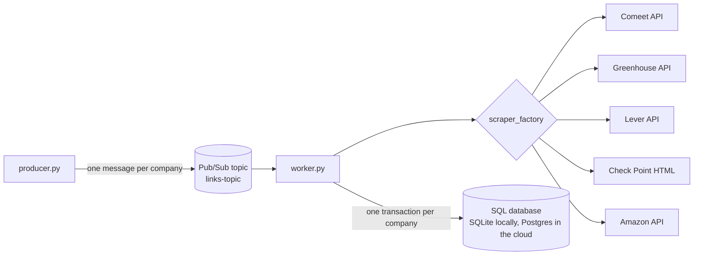

# jobscan-ai

Collects open roles in Israel from about 100 tech companies into one database, as the
first stage of a CV-to-job matcher. Instead of scraping HTML, it reads the public job
APIs that companies' own career pages use (Comeet, Greenhouse, Lever), plus custom
scrapers for Check Point and Amazon. A run in September 2026 stored 1,368 open roles.

## How it works



1. **producer.py** reads the active companies from `target_sites` and publishes one
   Pub/Sub message per company.
2. **worker.py** receives each message, picks the scraper by `target_sites.name`, and
   saves the result. It acks only after the database commit; a scraper or database
   error is nacked so Pub/Sub retries it. A message that can never succeed (bad JSON,
   unknown scraper) is logged and dropped instead of looping.
3. **infrastructure/db/sync_plan.py** decides what each run changes:
   - a posting is identified by the ATS's own id, not its URL;
   - edits to the title, location or description are written back;
   - postings that disappear are **closed, not deleted** (`closed_at`), and reopened if
     they come back;
   - if a scrape returns less than half of the open postings (an API hiccup), nothing
     is closed, except postings not seen for 7 days.

## Sources

| Scraper | Companies | How |
|---|---|---|
| Comeet | 50 | Careers API, one request per company, Israel by country code |
| Greenhouse | 38 | Job Board API with `content=true`: descriptions in one request |
| Lever | 15 | Postings API: description + requirement lists + closing text |
| Check Point | 1 | Paginated careers HTML (titles and locations, no descriptions yet) |
| Amazon | 1 | Internal search API; needs browser cookies in `AMAZON_JOBS_COOKIES` and `AMAZON_JOBS_API_KEY` |

Companies live in `seed_comeet_discovery.py`. Adding one is a new row there, no code change.

## Run it locally

Needs Python 3.10+ and the Pub/Sub emulator (part of the gcloud CLI).

```bash
pip install -r requirements-dev.txt

# 1. Pub/Sub emulator, in its own terminal
gcloud beta emulators pubsub start --project=jobscan-local-dev --host-port=localhost:8085

# 2. Database: build it and load the companies
python reset_db.py
python seed_comeet_discovery.py

# 3. Worker in one terminal, producer in another
cd services/discovery-agent
python worker.py
python producer.py
```

The code uses the emulator automatically when it isn't running on Cloud Run.
`WORKER_CONCURRENCY` (default 4) sets how many companies are scraped at the same time.

## Tests

```bash
python -m pytest tests
```

The tests never touch the network or your `jobs.db`: HTTP calls go to a fake session
and the database tests use a throwaway SQLite file.

## Configuration

| Variable | Default | Used for |
|---|---|---|
| `DATABASE_URL` | SQLite file in `infrastructure/db/jobs.db` | Postgres in the cloud |
| `PUBSUB_PROJECT_ID` / `GOOGLE_CLOUD_PROJECT` | `jobscan-local-dev` | Pub/Sub project |
| `PUBSUB_USE_EMULATOR` | on locally, off on Cloud Run | force the emulator on (1) or off (0) |
| `WORKER_CONCURRENCY` | 4 | messages processed at once |
| `AMAZON_JOBS_COOKIES`, `AMAZON_JOBS_API_KEY` | empty (Amazon skipped) | Amazon scraper |

## Roadmap

- `services/matcher-service`: score each open role against a candidate profile
  (must-have vs nice-to-have skills, years of experience) in both directions.
- Deploy to Google Cloud: Cloud Run for the worker, Cloud Scheduler for the producer,
  Cloud SQL for Postgres, and a dead-letter topic for messages that keep failing.
- `services/api-server`: an API for the matches.
